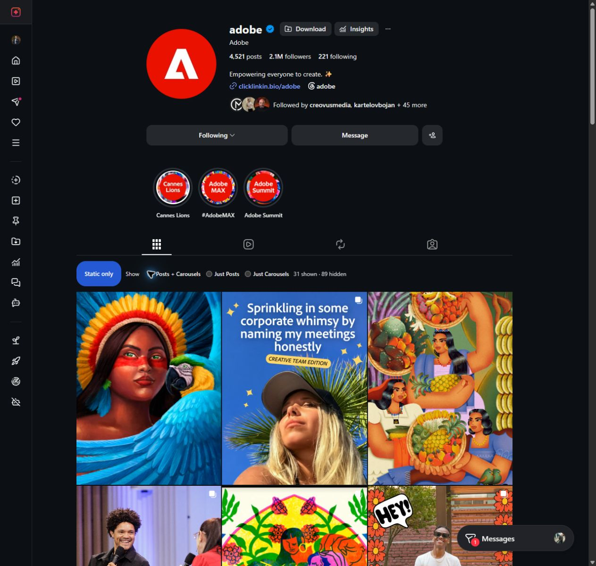
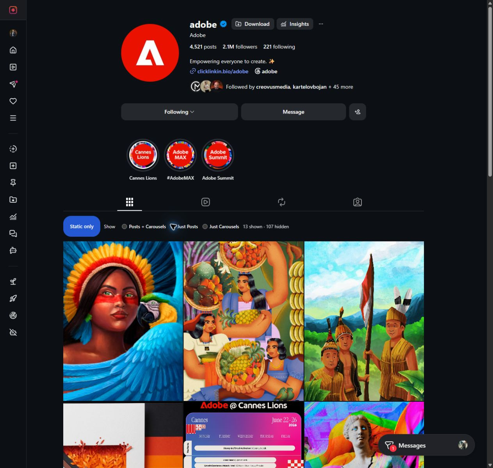
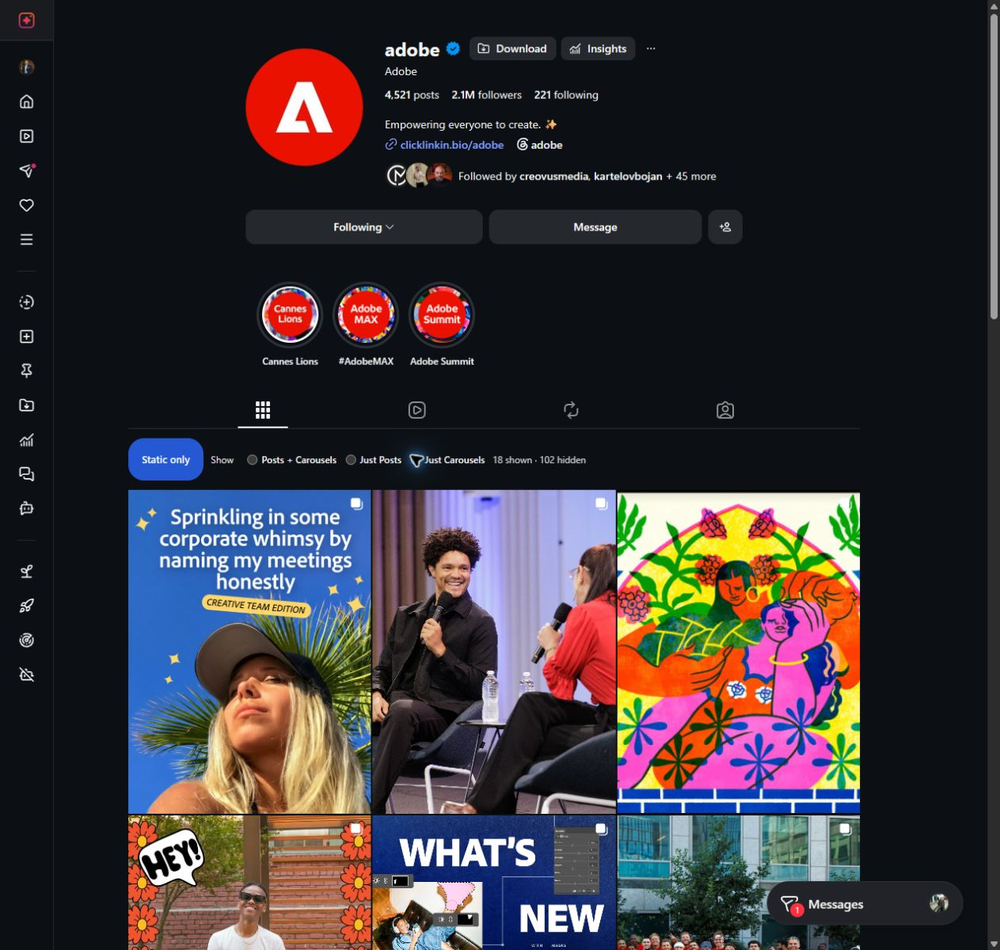

# Instagram Static Filter

A Chrome extension for reviewing Instagram profile aesthetics without mixing Reels into the grid. It filters only a profile's **Posts** tab and keeps Instagram's original post links and order.

## Install

The easiest option is to download the latest [release ZIP](https://github.com/samiburgaz/instagram-static-filter/releases/latest/download/instagram-static-filter-v0.1.4.zip):

1. Extract the ZIP into a folder that will stay on your computer.
2. Open `chrome://extensions` in Chrome and turn on **Developer mode**.
3. Choose **Load unpacked** and select the extracted folder containing `manifest.json`.
4. Refresh an Instagram profile's **Posts** tab.

For the current source instead, clone this repository and load its `extension/` folder.

## Use

Turn on **Static only**, then choose a filter:

- **Posts + Carousels** keeps both single-image posts and all carousels, including mixed-media carousels.
- **Just Posts** keeps single-image posts.
- **Just Carousels** keeps carousels.

Identifiable Reels and videos are hidden in every mode. Unknown post types stay visible. The extension keeps the selected mode, supports three-, four-, and six-column grids, and preserves enough scroll space to let Instagram load more posts while filtering is active.

## Screenshots

Examples from [Adobe's public Instagram profile](https://www.instagram.com/adobe/) show how each mode changes the same grid:

| Posts + Carousels | Just Posts | Just Carousels |
| --- | --- | --- |
|  |  |  |

These examples display posts and branding from Adobe's public Instagram account. That content remains Adobe's; a license for this repository would cover only material the repository author has rights to license.

Turn off **Static only** to restore the full grid. The filter is not applied to Instagram's home feed, Reels, or Tagged tabs.

## Privacy and permissions

The extension runs only on `instagram.com` and `www.instagram.com`. It uses Chrome's `storage` permission to save the enabled state and selected mode locally. It has no backend, analytics, history access, or additional network requests.

## Development

Requires Node.js 20 or newer.

```sh
npm ci
npm test
```

To load a local development copy, choose `extension/` in `chrome://extensions`. Reload the extension and refresh Instagram after editing it.

## License

The original project code is licensed under the [MIT License](LICENSE). The screenshots are illustrative images of Adobe's public Instagram content and branding; those rights remain with Adobe and they are not covered by the repository's MIT license.
